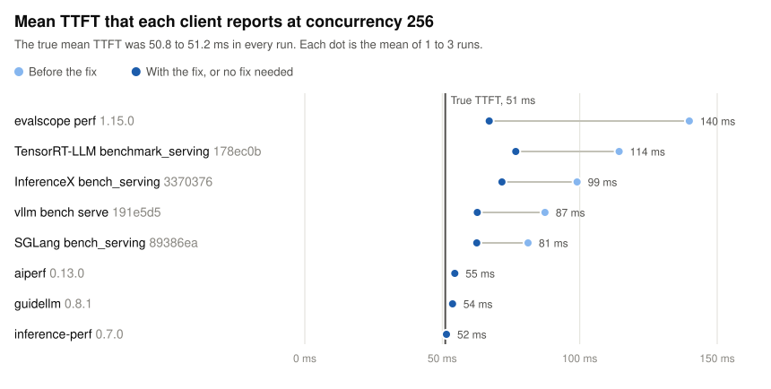
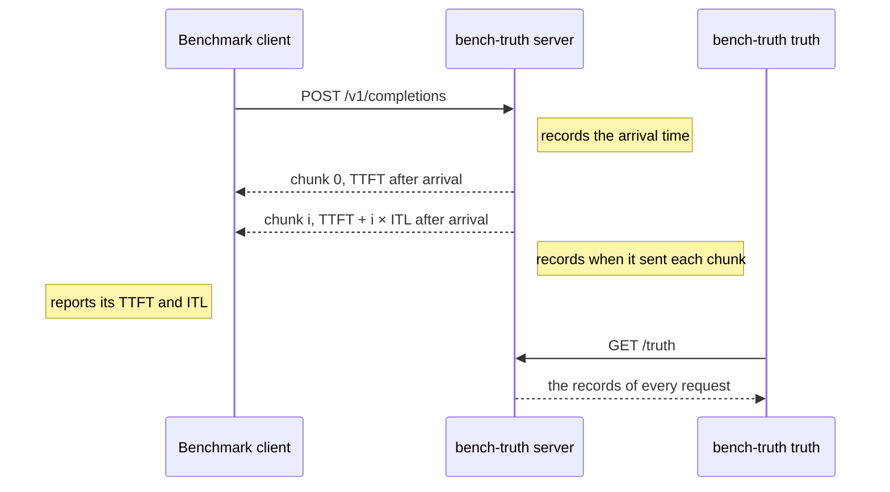

# bench-truth

[](https://github.com/oscar030406/bench-truth/actions/workflows/check.yml)
[](https://github.com/oscar030406/bench-truth/releases)
[](pyproject.toml)
[](LICENSE)

A streaming server with known timings, for checking the numbers that LLM serving benchmarks report.

<p align="center">
  <picture>
    <source media="(prefers-color-scheme: dark)" srcset="docs/assets/ttft-c256-dark.svg">
    
  </picture>
</p>

Benchmark clients such as `vllm bench serve`, guidellm and aiperf report time to first token (TTFT), inter-token latency (ITL) and throughput. People pick engines and settings from these numbers. The bench-truth server sends every chunk at a planned time and records when it sent each one. So each number that a client reports has a true value to compare with.

## What it found

At concurrency 256, five clients reported a mean TTFT between 81 and 140 ms, against a true TTFT of 51 ms in every run. Two causes explain most of the error. Both add their delay after the client starts its TTFT clock.

- With `trust_env=True`, aiohttp 3.14.5 runs two lookups in a thread pool for every request. At concurrency 256, they delay each request by 26 ms ([aio-libs/aiohttp#14378](https://github.com/aio-libs/aiohttp/issues/14378)).
- A client that opens an aiohttp session for every request also opens a connection for every request.

| Client | Cause | Before the fix | With the fix | Fix |
|---|---|---|---|---|
| evalscope `perf` 1.15.0 | `trust_env` | 144.1, 135.7 ms | 66.5, 67.6 ms | [#2088](https://github.com/modelscope/evalscope/pull/2088) |
| TensorRT-LLM `benchmark_serving` `178ec0b` | `trust_env`, `force_close` | 114.5, 114.1 ms | 77.9, 75.6 ms | [#22283](https://github.com/NVIDIA/TensorRT-LLM/pull/22283) |
| InferenceX `bench_serving` `3370376` | `trust_env`, a session for every request | 96.1, 102.0 ms | 72.9, 70.5 ms | [#5088](https://github.com/SemiAnalysisAI/InferenceX/pull/5088) |
| `vllm bench serve` `191e5d5` | `trust_env` | 87.4 ms | 62.8 ms | [#67624](https://github.com/vllm-project/vllm/pull/67624) |
| SGLang `bench_serving` `89386ea` | a session for every request | 71.7, 74.3, 97.5 ms | 63.2, 62.9, 61.5 ms | [#50505](https://github.com/sgl-project/sglang/pull/50505) |

aiperf 0.13.0, guidellm 0.8.1 and inference-perf 0.7.0 reported 54.6, 53.7 and 51.5 ms in the same test. They need no fix.

Each number is the mean TTFT that the client printed for one run. The first burst of a run opens all its connections at once, and TensorRT-LLM and InferenceX open a connection for every request. The fixes keep both costs, so the numbers with the fix stay above the truth. The file [docs/findings.md](docs/findings.md) gives the numbers after the first burst and the cause in each client. It also covers LMDeploy, whose error is 1.4% to 1.6%. The raw numbers are in [`results/`](results).

## Requirements

- Linux, macOS or Windows, on x86-64 or arm64.
- Python 3.10 or later.
- The benchmark client and the server on one machine. Network delay between two machines would add to the client's TTFT.

## Install

Install the `bench-truth` command, with the Python server and the tools that read the truth:

```bash
pip install git+https://github.com/oscar030406/bench-truth
```

The Python server is for low concurrency. For high concurrency, use the Rust server: its own time to the first token stays at 51 ms up to concurrency 1024. Each release has a server binary for each platform:

| | x86-64 | arm64 |
|---|---|---|
| Linux, static | [`bench-truth-server-x86_64-linux.tar.gz`](https://github.com/oscar030406/bench-truth/releases/latest/download/bench-truth-server-x86_64-linux.tar.gz) | [`bench-truth-server-aarch64-linux.tar.gz`](https://github.com/oscar030406/bench-truth/releases/latest/download/bench-truth-server-aarch64-linux.tar.gz) |
| macOS | [`bench-truth-server-x86_64-macos.tar.gz`](https://github.com/oscar030406/bench-truth/releases/latest/download/bench-truth-server-x86_64-macos.tar.gz) | [`bench-truth-server-aarch64-macos.tar.gz`](https://github.com/oscar030406/bench-truth/releases/latest/download/bench-truth-server-aarch64-macos.tar.gz) |
| Windows | [`bench-truth-server-x86_64-windows.zip`](https://github.com/oscar030406/bench-truth/releases/latest/download/bench-truth-server-x86_64-windows.zip) | [`bench-truth-server-aarch64-windows.zip`](https://github.com/oscar030406/bench-truth/releases/latest/download/bench-truth-server-aarch64-windows.zip) |

For example, on x86-64 Linux:

```bash
curl -sL https://github.com/oscar030406/bench-truth/releases/latest/download/bench-truth-server-x86_64-linux.tar.gz | tar xz
./bench-truth-server --version
```

To build the server from source, install Rust 1.85 or later and run `cargo build --release --manifest-path server-rs/Cargo.toml`.

## Usage

Do these steps on one machine:

1. Start the server.
2. Run a benchmark client against it. This example uses `bench-truth reference`, a minimal aiohttp client.
3. Print what the server sent, and compare it with what the client reported.

```bash
./bench-truth-server --scenario fast --itl 0.02 --port 8100 &
bench-truth reference --concurrency 16
bench-truth truth --last 64 --concurrency 16 --clear
```

`bench-truth reference` prints its mean TTFT. It splits the TTFT into the wait before the server's handler starts and the server's own time to the first token:

```text
c=16 before handler: first burst 1.84 ms, later 0.15 ms
c=16 client ttft 52.06 ms = before handler 0.57 + server first token 51.07 + rest
```

`bench-truth truth` prints the truth for the same 64 requests. `--concurrency 16` summarises the first 16 requests apart from the rest, because the first burst opens all its connections at once. `--clear` then deletes the records, so that the next run starts with an empty `/truth`.

```json
{
  "all": {
    "requests": 64,
    "mean_ttft_ms": 51.074,
    "mean_itl_ms": 20.0,
    "mean_tpot_ms": 20.0,
    "output_tokens": 16384
  },
  "first_burst": {
    "requests": 16,
    "mean_ttft_ms": 51.009,
    "mean_itl_ms": 20.0,
    "mean_tpot_ms": 20.0,
    "output_tokens": 4096
  },
  "after_first_burst": {
    "requests": 48,
    "mean_ttft_ms": 51.096,
    "mean_itl_ms": 20.0,
    "mean_tpot_ms": 20.0,
    "output_tokens": 12288
  }
}
```

To check another client, run it in step 2 instead, with the server as its endpoint. For example, the `vllm bench serve` runs in [docs/findings.md](docs/findings.md) used this command:

```bash
vllm bench serve --backend openai --base-url http://127.0.0.1:8100 --model bench-truth \
  --tokenizer Qwen/Qwen3-32B --dataset-name random --random-input-len 16 \
  --random-output-len 256 --num-prompts 1024 --max-concurrency 256
bench-truth truth --last 1024 --concurrency 256 --clear
```

`--last` keeps the last requests by arrival time. This drops the warmup and test requests that many clients send first. Compare `mean_ttft_ms` and `mean_itl_ms` with the numbers that the client reports.

### Scenarios

| Name | TTFT | Time between tokens | Tokens | Note |
|---|---|---|---|---|
| `uniform` | 50 ms | 20 ms | 64 | |
| `slow_first` | 500 ms | 10 ms | 64 | |
| `usage_eos` | 50 ms | 20 ms | 64 | `usage.completion_tokens` counts one token more than the stream holds |
| `fast` | 50 ms | 5 ms | 256 | |

`--ttft`, `--itl` and `--tokens` change one value of the scenario. By default, chunk i carries the text ` t{i}`. With `--word the`, every chunk carries ` the`, which the Qwen3 tokenizer counts as one token. Use it for clients that count tokens by tokenizing the text.

With `usage_eos`, `vllm bench serve` reports 1.6% more output tokens and 1.6% lower time per output token, because it takes the count from `usage`. guidellm reports the same kind of error in [guidellm#1565](https://github.com/vllm-project/guidellm/issues/1565).

### Commands

| Command | What it does | Options |
|---|---|---|
| `bench-truth-server` | Runs the Rust server. | `--scenario`, `--ttft`, `--itl`, `--tokens`, `--word`, `--host`, `--port` |
| `bench-truth serve` | Runs the Python server. | The same options |
| `bench-truth truth` | Reads `/truth` and prints the true TTFT, ITL and time per output token. | `--url`, `--last`, `--concurrency`, `--clear` |
| `bench-truth reference` | Runs a minimal aiohttp client that splits its TTFT. | `--url`, `--concurrency`, `--requests`, `--trust-env`, `--session-per-request` |

Both servers speak the OpenAI streaming API on `/v1/completions` and `/v1/chat/completions`. They send the final usage chunk only when the request sets `stream_options.include_usage`, as the OpenAI API does. `GET /truth` returns the records, and `DELETE /truth` deletes them.

## How it works



- A record holds the `x-bt-id` header if the client sent one, the arrival time `arrived`, the token count, and the send time of each chunk after `arrived`.
- The server records each chunk just before it writes the chunk. So no client can read a chunk before its record.
- `arrived` is on the clock of Python's `time.perf_counter()`: `CLOCK_MONOTONIC` on Linux, `mach_absolute_time` on macOS and `QueryPerformanceCounter` on Windows. So a client on the same machine can compare its own timestamps with the records. `bench-truth reference` uses this to split its TTFT.
- A packet capture checks the records of the Rust server. At every concurrency from 16 to 1024, the median chunk left 0.002 ms after its record ([docs/accuracy.md](docs/accuracy.md)).

## Tests

Run `bash check.sh`. It runs ruff, cargo fmt, clippy, the Rust build, the chart check and the same protocol tests against both servers. It needs `uv` and `cargo`. On Windows, run it in Git Bash. CI runs it on Linux, macOS and Windows, each on x86-64 and arm64.

## Limitations

- The client and the server run on one machine. Network delay between machines is not part of the measurement.
- The results in [docs/findings.md](docs/findings.md) come from a WSL2 guest. Its monotonic clock ran about 8% slower than the host's (27.6 s against 30.1 s). The server and the clients read the same guest clock, so the relative errors hold. The absolute times are in guest seconds.
- The Rust server's timer has millisecond resolution. Each chunk can leave up to about 1 ms late, and `/truth` records when it actually left.
- Windows wakes timers less exactly. On a busy Windows 11 machine, chunks left a median of 1 to 6 ms late. In WSL on the same machine, they left 1.2 ms late. `/truth` records the actual times on every platform.

## License

Apache-2.0
